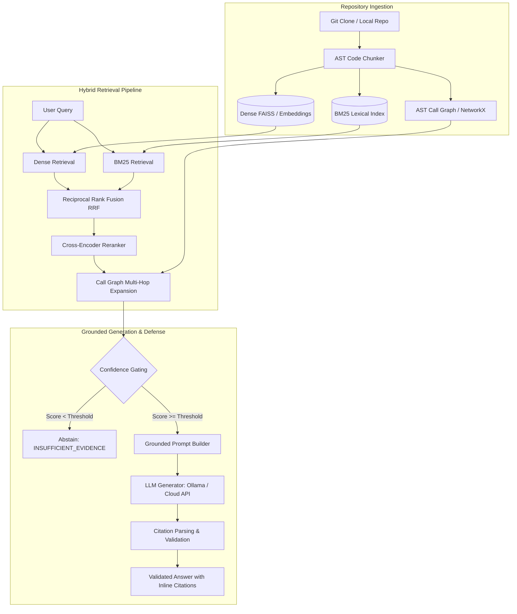

# 🧠 Codebase Understanding Assistant

[](https://www.python.org/)
[](https://fastapi.tiangolo.com/)
[](https://react.dev/)
[](https://tailwindcss.com/)
[](LICENSE)

An end-to-end, full-stack **Grounded Retrieval-Augmented Generation (RAG) Codebase Assistant**. It allows developers to index any GitHub repository and perform conversational codebase exploration, multi-hop dependency tracing, and citation-backed question answering with strict hallucination defense.

---

## 🌟 Key Highlights

- **Full-Stack Application**:
  - **Backend**: FastAPI REST API providing asynchronous indexing, multi-stage hybrid retrieval, and multi-LLM generation.
  - **Frontend**: Clean React + Tailwind CSS web interface with real-time indexing status, streaming query responses, citation viewer, and model selection.
- **AST-Based Syntactic Code Parsing**:
  - Parses Python files into semantic chunks (functions, classes, methods, docstrings, decorators) preserving file paths and exact line numbers.
- **Hybrid Multi-Stage Retrieval**:
  - **Dense Embeddings**: Pretrained semantic representations (`sentence-transformers`) for code-to-text similarity.
  - **Sparse Lexical Search**: BM25 keyword matching for exact identifiers, function names, and error strings.
  - **Reciprocal Rank Fusion (RRF)**: Merges dense and sparse rankings with cross-encoder reranking.
  - **Call-Graph Multi-Hop Expansion**: Navigates caller-callee chains using NetworkX to pull in cross-file dependencies.
- **Grounded Generation & Citation Verification**:
  - **Confidence Gating**: Detects queries with low evidence and abstains (`INSUFFICIENT_EVIDENCE`) to prevent hallucinations.
  - **Strict Source Attribution**: Prompts enforce verifiable `[file:lines]` source citations.
  - **Automated Citation Validator**: Verifies cited ranges against retrieved repository evidence.
- **Multi-Provider LLM Support**:
  - **Local (CPU/GPU)**: Ollama (e.g. `llama3.2:3b`) — zero API cost and private.
  - **Cloud APIs**: Groq, Google Gemini, Anthropic Claude.
- **Experimental Notebooks**:
  - In-depth evaluation notebooks (`ta_last_updated.ipynb`, `ta_last_updated_fixed.ipynb`) with CodeSearchNet benchmarks and a 55-question held-out repository evaluation.

---

## 🏗️ Architecture & Pipeline



---

## 📁 Repository Structure

```
codebase-assistant/
│
├── backend/                        # FastAPI RAG Backend
│   ├── app/
│   │   ├── chunker.py             # AST Python code parser & chunker
│   │   ├── indexer.py             # Dense & BM25 indexer + Call graph
│   │   ├── retriever.py           # Hybrid retrieval, RRF, reranking & expansion
│   │   ├── generator.py           # Multi-LLM provider abstraction
│   │   ├── pipeline.py            # Grounded prompt engineering & citation validator
│   │   ├── main.py                # FastAPI endpoints
│   │   └── schemas.py             # Pydantic data schemas
│   ├── tests/                     # Backend test suite (pytest)
│   │   ├── conftest.py
│   │   └── test_pipeline.py
│   ├── .env.example               # Configuration template
│   ├── README.md                  # Backend documentation
│   └── requirements.txt           # Python dependencies
│
├── frontend/                       # React + Vite + Tailwind CSS Web UI
│   ├── src/
│   │   ├── App.jsx                # Main application UI
│   │   ├── main.jsx               # Entry point
│   │   └── index.css              # Tailwind styles
│   ├── package.json               # Frontend dependencies & scripts
│   ├── vite.config.js             # Vite build configuration
│   └── tailwind.config.js         # Tailwind configuration
│
├── scripts/                        # Automation & testing scripts
│   ├── smoke_test.py              # Automated API health & indexing test
│   └── smoke_test.sh              # Bash smoke test script
│
├── ta_last_updated.ipynb          # Comprehensive research & evaluation notebook
├── ta_last_updated_fixed.ipynb    # Evaluation notebook with calibration fixes
├── .gitignore                     # Git ignore rules for Python, Node, indices, and OS files
└── README.md                      # Project documentation
```

---

## 🚀 Quick Start Guide

### 1. Prerequisites
- Python 3.10+
- Node.js 18+ & npm
- [Ollama](https://ollama.com/) (recommended for local execution)

---

### 2. Backend Setup

```bash
cd backend

# Create and activate virtual environment
python -m venv venv
# On Windows:
venv\Scriptsctivate
# On Linux/macOS:
source venv/bin/activate

# Install dependencies
pip install -r requirements.txt

# Configure environment variables
cp .env.example .env
# Edit .env if using cloud APIs; default is set to local Ollama

# Pull local LLM model (if using Ollama)
ollama pull llama3.2:3b

# Start the backend server
uvicorn app.main:app --reload --host 0.0.0.0 --port 8000
```

The backend API will be live at `http://localhost:8000`. You can inspect interactive API documentation at `http://localhost:8000/docs`.

---

### 3. Frontend Setup

In a new terminal:

```bash
cd frontend

# Install dependencies
npm install

# Start Vite development server
npm run dev
```

Open `http://localhost:5173` in your browser.

---

### 4. Running the Smoke Test

To verify all components (indexing, retrieval, generation):

```bash
python scripts/smoke_test.py
```

---

## 📡 API Reference

| Method | Endpoint | Description |
|---|---|---|
| `POST` | `/index` | Clones and indexes a GitHub repository |
| `GET` | `/index/status/{job_id}` | Polls indexing progress |
| `POST` | `/ask` | Asks a grounded question about the indexed codebase |
| `GET` | `/file` | Retrieves source code by file path and line numbers |
| `GET` | `/stats` | Returns index statistics (chunks, tokens, graphs) |
| `GET` | `/models` | Lists available LLM providers |
| `GET` | `/health` | Health check |

---

## 🧪 Evaluation Metrics & Benchmarks

The accompanying notebooks (`ta_last_updated.ipynb`) evaluate the system on:
- **CodeSearchNet**: Pretrained embedding evaluation ($Hit@1, Hit@3, Hit@5$).
- **55-Question Held-Out Benchmark**:
  - **Hit@k & MRR**: Accuracy of retrieved files for single-file and cross-file dependencies.
  - **Citation Accuracy**: Verifiable reference tracking to ground-truth files.
  - **Abstention Accuracy**: Correct rejection of queries without evidence (`INSUFFICIENT_EVIDENCE`).
  - **Hallucination Defense**: Measurement of unsupported vs. grounded factual answers.

---

## 📜 License

This project is licensed under the [MIT License](LICENSE).
